<div align="center">

# Limusic for Android

**A native Android YouTube Music client. Kotlin + Jetpack Compose, ad-free.**

<p align="center">
  <a href="https://github.com/SimoHypers/limusic-android/releases/latest"></a>
  <a href="https://github.com/SimoHypers/limusic-android/releases/latest"></a>
  
  <a href="https://simohypers.github.io/limusic/"></a>
  <a href="https://ko-fi.com/simohypers"></a>
  <br>
  
  
  
</p>

**Limusic for Android** is the phone side of [Limusic](https://github.com/SimoHypers/limusic).
It talks directly to YouTube's internal API and plays through Media3: no backend server, no ads
in the audio. It started as a fork of [SimpMusic](https://github.com/maxrave-dev/SimpMusic) by
maxrave-dev and its contributors, cut down and rebuilt to work like the desktop app.

</div>

---

## Features

- **Ad-free playback**: streams come straight from YouTube's API, ads never do
- **Search & browse**: songs, albums, artists, playlists and the YTM home feed, with Quick picks up top
- **A Home you arrange**: pin library items as Shortcuts, then set the card size, mood chips and section order in Edit Home
- **Sign in** with your YouTube Music account, several accounts at once with switching between them
- **Your library, on YouTube Music**: likes, follows and saves go to your account; playlists, albums, artists and songs in the desktop's tabs; create, edit, sort and delete playlists. Signed out, everything stays on the phone and moves over later with one tap
- **Queue** with radio and autoplay that work like the desktop's: history above what's playing, no duplicates if you want, shuffle that sticks across queues
- **Synced lyrics**: word by word where the source has the timings, a source picker and timing nudge per song, providers in the order you choose
- **Downloads**: tap a playlist or album and it's on the phone; download the whole library at once, keep it downloaded as it grows, Wi-Fi only if you like
- **Music videos**: optional, the video plays instead of the cover
- **Three player styles**: Limusic's Classic, Material 3 Expressive and Apple Music, with Apple Music's animated artwork where a song has it
- **Colors from the cover**: the playing artwork tints the whole app
- **Themes**: Default, Catppuccin, Caffeine, AMOLED, Neon and Material You, light or dark, with your own accent, fonts and corner roundness
- **Sound**: loudness normalization, crossfade (beta), a ten-band equalizer, playback speed and pitch, and a sleep timer
- **Last.fm scrobbling**: approve once in the browser, then a live card shows what each play scrobbles as, with timing settings and rules that clean up titles
- **Discord Rich Presence**: sign in with Discord, then tap the live card preview to choose what it shows
- **Listen Together**: the same rooms as Limusic desktop, so phones and computers listen in sync
- **Play anywhere**: link the phone to Limusic on your computer, control either one from the other and move the music between them
- **Android Auto**, lock screen and notification controls, and playback that keeps going in the background

---

## Screenshots

<table>
  <tr>
    <td>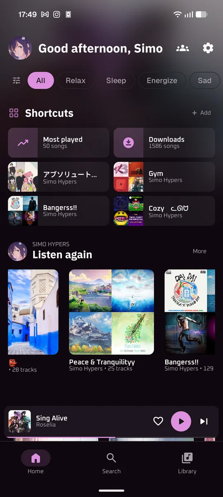</td>
    <td>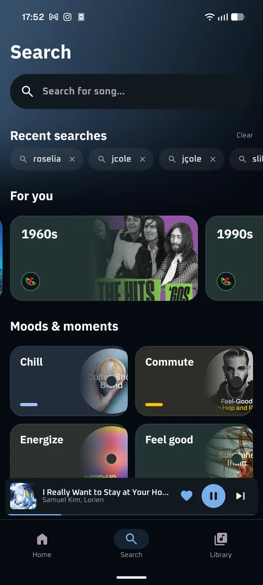</td>
    <td>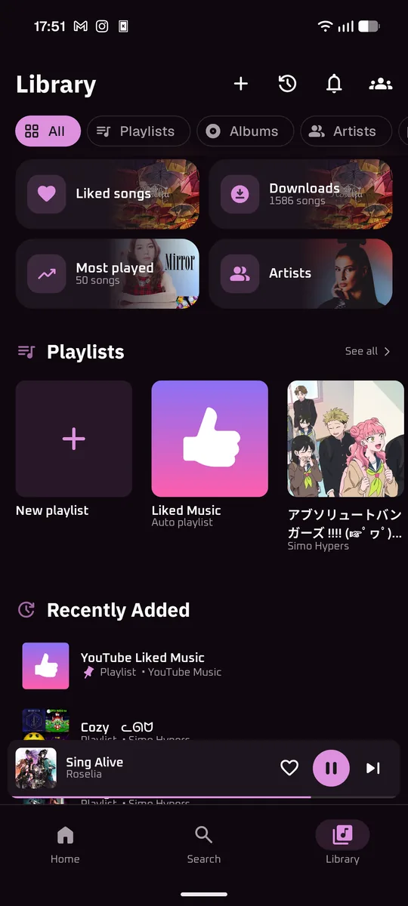</td>
  </tr>
  <tr>
    <td>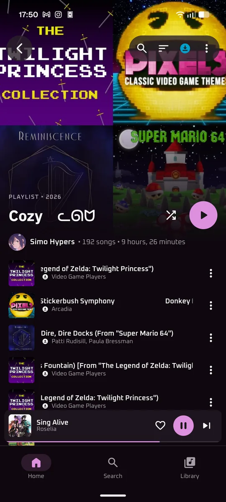</td>
    <td>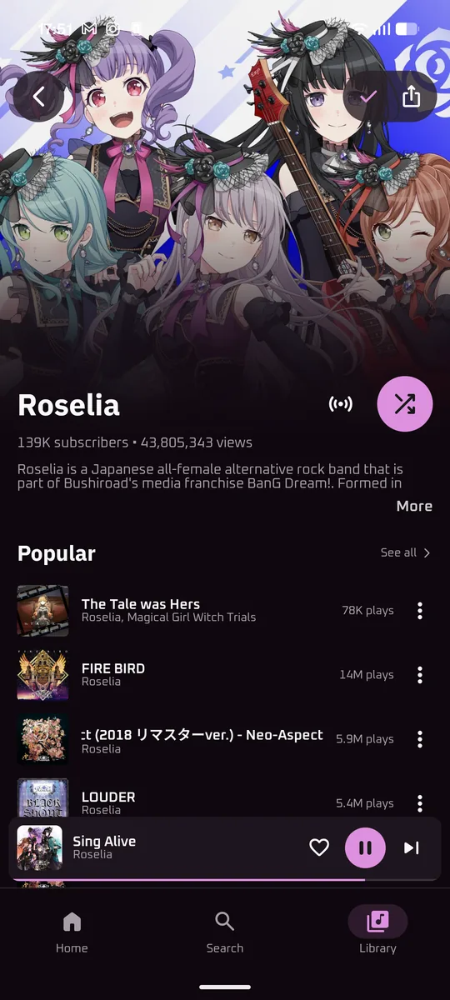</td>
    <td>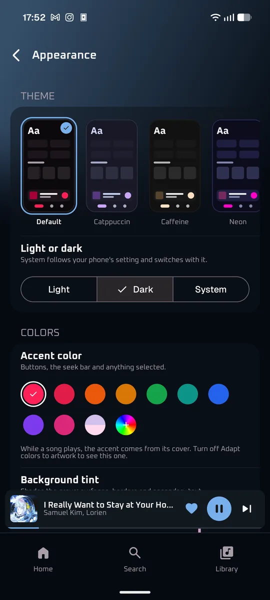</td>
  </tr>
  <tr>
    <td>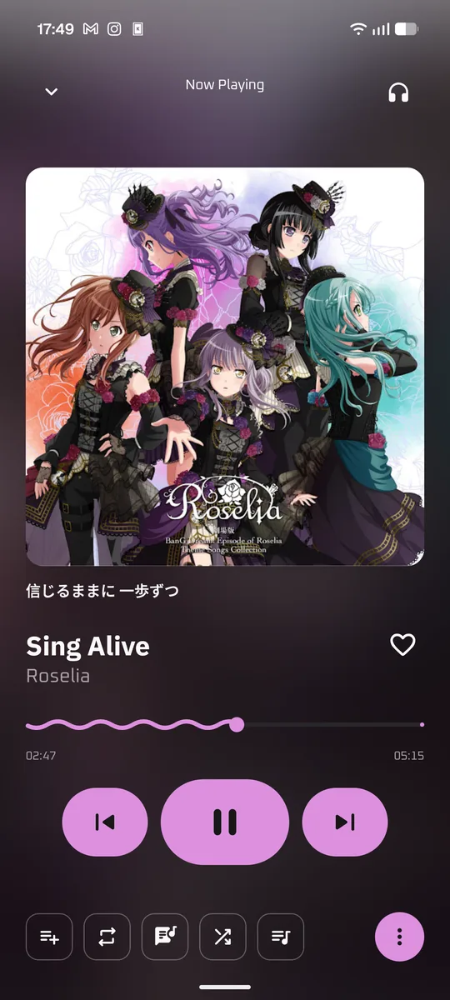</td>
    <td>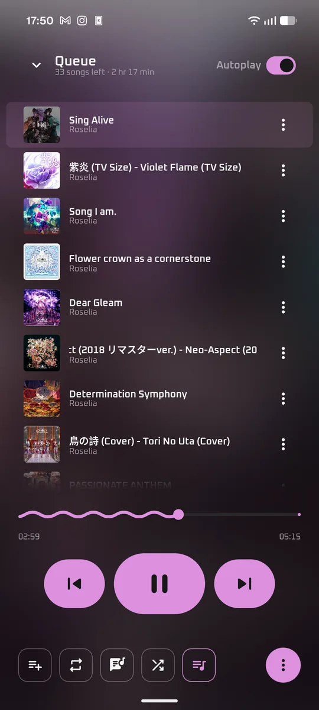</td>
    <td>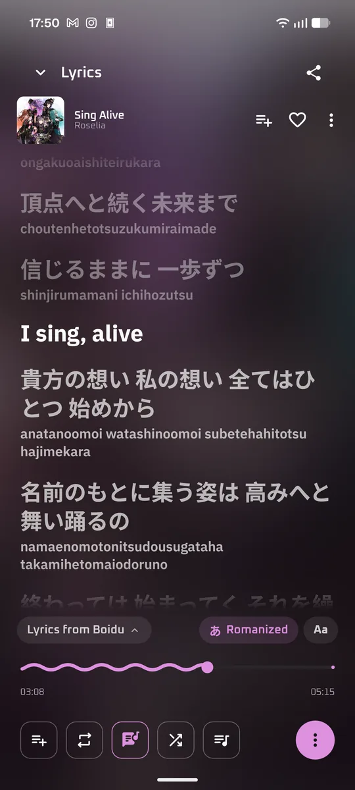</td>
  </tr>
  <tr>
    <td align="center">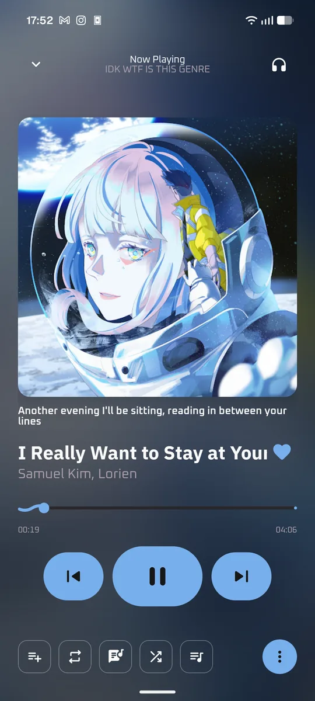<br><sub>Classic</sub></td>
    <td align="center">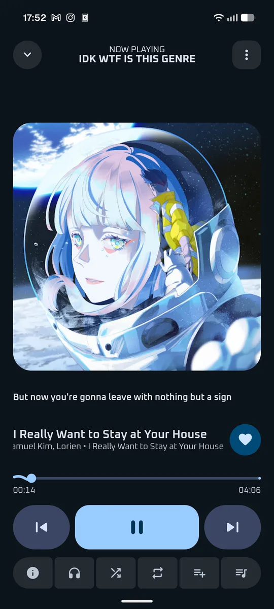<br><sub>Material 3 Expressive</sub></td>
    <td align="center">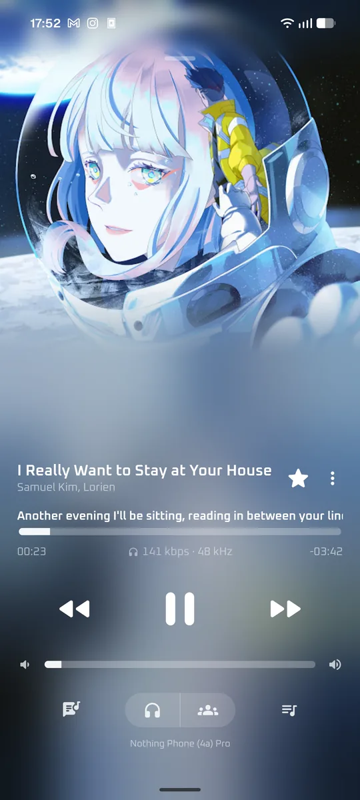<br><sub>Apple Music</sub></td>
  </tr>
</table>

---

<h2 align="center">Download & Install</h2>

<p align="center">
  <a href="https://github.com/SimoHypers/limusic-android/releases/latest">
    
  </a>
</p>

| File | For | Size |
|---|---|---|
| `-arm64-v8a.apk` | Nearly every phone from the last ten years. Pick this one if unsure | ~23 MB |
| `-armeabi-v7a.apk` | Older 32-bit phones | ~23 MB |
| `-x86_64.apk` | Emulators and Chromebooks | ~25 MB |
| `-universal.apk` | Any of the above, at twice the size | ~49 MB |

Needs Android 8.0 or newer. Android asks once for permission to install apps from your browser or
file manager. After that Limusic updates itself: a banner (and a notification, if you want one)
says when a new version is out, and Update downloads and installs it. Your library, downloads and
sign-in stay. To get release candidates a few days early, turn on **Beta versions** in
**Settings -> About**.

---

## Scrobbling & Discord

Both live in Settings.

- **Last.fm**: tap Connect Last.fm, approve Limusic in the browser tab that opens,
  and come back connected. Tracks scrobble at the halfway point (or four minutes,
  whichever comes first) unless you move the timing sliders. The page shows your
  profile and a Now scrobbling card comparing YouTube's metadata with what Last.fm
  gets, and the rules (the desktop's presets, or your own) fix titles before they
  are sent. The scrobble switch pauses it without disconnecting.
- **Discord**: tap Sign in with Discord and approve in the browser. Limusic only
  gets to set what you are listening to. The card at the top of the page is a live
  preview: tap a part of it to change what it shows.

Building from source? Last.fm needs your own API credentials, and they are not in
the repo. Get a key at [last.fm/api/account/create](https://www.last.fm/api/account/create)
and add it to `local.properties`:

```
LASTFM_API_KEY=your_key
LASTFM_SECRET=your_secret
```

Without them everything else still builds and runs.

---

## Lyrics

Lyrics come from [Boidu](https://boidu.dev), Unison and LyricsPlus first, then
[LRCLIB](https://lrclib.net), YouTube Music's own lyrics, Netease, QQ Music and
Kugou, and synced lyrics beat plain text. Matching is keyed on the track's
length, because popular songs exist as several cuts and the wrong one drifts out
of time. Results are cached on the phone, so replaying a track is instant.

Boidu, Unison and LyricsPlus are the sources with per-word timings, which is what
lets a line highlight word by word as it's sung. Change the order or switch any source
off in **Settings -> Lyrics -> Lyrics sources**.

In the Classic player's lyrics page, the source chip at the bottom shows where
the lyrics came from. Tap it to see every provider's answer for that song, pick
one, search by title, or nudge the timing. The pick sticks for that song.

---

## Listen Together

Synced listening with friends. Everyone streams their own audio from YouTube;
the room only relays play/pause, seeks, track changes and the queue. Open it from
the icon in Home's header, start a room and share the code, or join with
someone's code. The host approves every join.

Rooms run on the same relay as Limusic desktop, so a phone can join a room hosted
on a computer and the other way round. A room on a self-hosted relay shares an
invite of the form `CODE@host`, and pasting that joins it there.

---

## Play Anywhere

Link the phone to Limusic on your computer once and the two control each other.
On the computer, open **Settings -> Devices -> Link a phone** and it shows a code.
On the phone, open **Settings -> Devices** and type it in. The link stays until
you unlink it on either side.

While the computer plays, the phone's own player shows it, marked Playing on
your computer's name: the mini player, the full player, the queue and the lyrics
all drive the computer, and tapping a song or a playlist plays it there. The
notification, the lock screen and the volume keys control it too. When the phone
plays, the computer shows and controls the phone the same way.

To move the music, tap the headphones button in the player and pick the
computer, or This phone to bring it back. It carries on from the same song and
position, and only one device plays at a time.

It goes through the same relay as Listen Together, so the phone and the computer
don't need to be on the same Wi-Fi.

---

## Building from Source

Needs JDK 21 and the Android SDK.

```bash
./gradlew :androidApp:assembleDebug
```

The APKs land in `androidApp/build/outputs/apk/debug/`. Release builds sign with
your own key: point `limusic.signing` in `local.properties` at a properties file
holding `storeFile`, `storePassword`, `keyAlias` and `keyPassword`.

---

## How It Works, Briefly

- SimpMusic's Kotlin client speaks YouTube's InnerTube API. Streams are resolved
  the way the desktop app does it: the web client with a PoToken first, then the
  VISIONOS and TVHTML5_SIMPLY identities when one fails.
- The PoToken comes from BotGuard, run in a hidden WebView. The signature cipher
  and the `n` parameter are solved on the phone in QuickJS, and never sent to a
  third-party server.
- Audio goes through Media3 ExoPlayer with an on-disk cache, inside a foreground
  service whose media session drives the notification, lock screen and Android Auto.
- Your library, downloads and lyrics cache live in a Room database on the phone.

---

## Star History

<a href="https://www.star-history.com/?repos=simohypers%2Flimusic-android&type=date&legend=top-left">
 <picture>
   <source media="(prefers-color-scheme: dark)" srcset="https://api.star-history.com/chart?repos=simohypers/limusic-android&type=date&theme=dark&legend=top-left" />
   <source media="(prefers-color-scheme: light)" srcset="https://api.star-history.com/chart?repos=simohypers/limusic-android&type=date&legend=top-left" />
   
 </picture>
</a>

---

## Support

Limusic is free and stays free. If it earned a coffee,
[ko-fi.com/simohypers](https://ko-fi.com/simohypers) is where to leave one.

---

## Credits

- [SimpMusic](https://github.com/maxrave-dev/SimpMusic) by maxrave-dev and its
  contributors: the app this one grew from, and most of its code
- [NewPipe](https://github.com/TeamNewPipe/NewPipe): the PoToken minter, ported to this app

---

## Disclaimer

This project is not affiliated with, funded, authorized, endorsed by, or in
any way associated with YouTube, Google LLC, or any of their affiliates and
subsidiaries.

All trademarks, service marks, and intellectual property rights referenced in
this project belong to their respective owners.

---

## License

[GPL-3.0](LICENSE), the license of SimpMusic, which this app is built on.
